# MiniMax H3 Image Batch

MiniMax H3 (Image, P-H3-Image and H3 video) only makes one image or clip per run in ComfyUI. Ask for more than one at a time and you get an error. These two nodes let one run make 2, 4 or more different images or separate videos, each with its own sound.

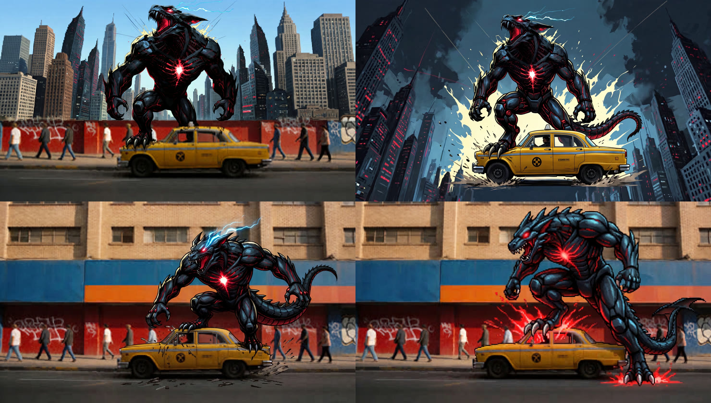
*One run, batch size 4, MiniMax H3 Image edit.*

## Results

Every image and clip below came from the official ComfyUI templates with these nodes added, one run each, batch size 2 unless it says otherwise.

### Images

<table>
  <tr>
    <th>Workflow</th>
    <th>Reference input(s)</th>
    <th>Both images from one run</th>
  </tr>
  <tr>
    <td>MiniMax H3 Image text to image</td>
    <td>text only</td>
    <td>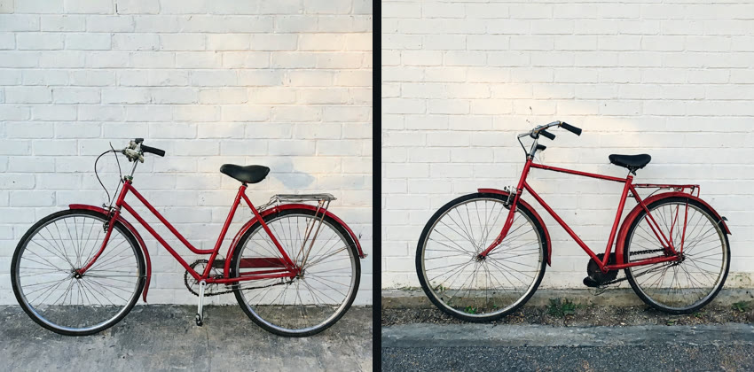</td>
  </tr>
  <tr>
    <td>MiniMax H3 Image edit</td>
    <td> </td>
    <td>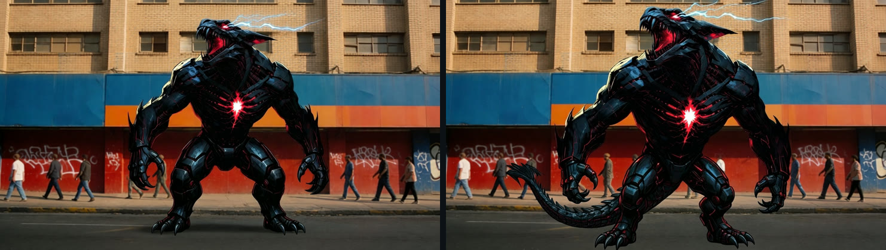</td>
  </tr>
  <tr>
    <td>P-H3-Image text to image</td>
    <td>text only</td>
    <td></td>
  </tr>
  <tr>
    <td>P-H3-Image edit</td>
    <td> </td>
    <td></td>
  </tr>
</table>

### Batch size 4

Four takes on one idea from a single run of the MiniMax H3 Image edit workflow, using the same taxi and dragon pictures as above. The prompt was:

> have the mecha dragon from &lt;Picture 2&gt; crushing the vintage yellow taxi in &lt;Picture 1&gt; with it's foot.


<details>
<summary>The workflow and prompt for this run</summary>
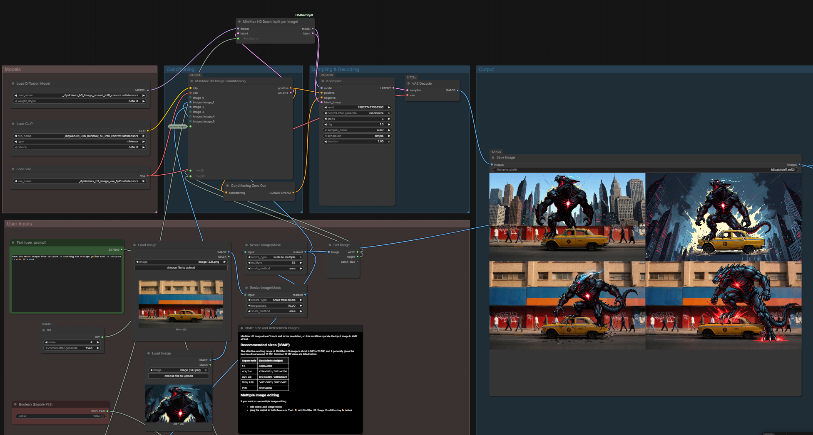
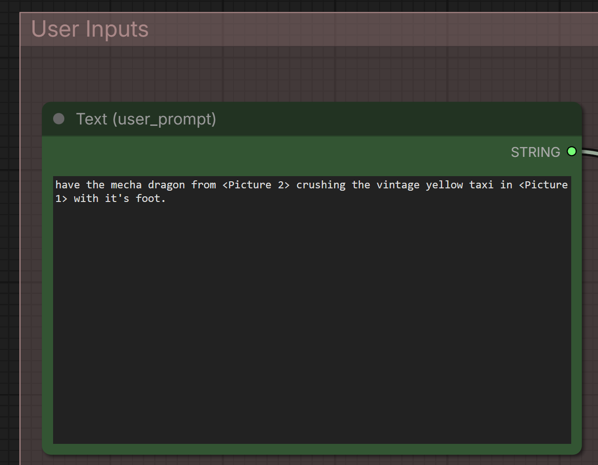
</details>

### Videos

<table>
  <tr>
    <th>Workflow</th>
    <th>Reference input(s)</th>
    <th>Both clips from one run</th>
  </tr>
  <tr>
    <td>text to video</td>
    <td>text only</td>
    <td>
      <br>
      <a href="assets/video/t2v_clip1.mp4">clip 1</a> · <a href="assets/video/t2v_clip2.mp4">clip 2</a> (mp4, with sound)
    </td>
  </tr>
  <tr>
    <td>image to video</td>
    <td></td>
    <td>
      <br>
      <a href="assets/video/i2v_clip1.mp4">clip 1</a> · <a href="assets/video/i2v_clip2.mp4">clip 2</a> (mp4, with sound)
    </td>
  </tr>
  <tr>
    <td>reference to video</td>
    <td> </td>
    <td>
      <br>
      <a href="assets/video/r2v_clip1.mp4">clip 1</a> · <a href="assets/video/r2v_clip2.mp4">clip 2</a> (mp4, with sound)
    </td>
  </tr>
</table>

The GIFs are silent previews; each mp4 is a separate file with its own sound, which is what the **separate videos** node is for.

## Installation

### ComfyUI Manager

Search "MiniMax H3 Image Batch".

### comfy-cli

```bash
comfy node install comfyui-h3-image-batch
```

### Git

```bash
cd ComfyUI/custom_nodes
git clone https://github.com/an80sPWNstar/comfyui-h3-image-batch.git
```

There is nothing else to install. Restart ComfyUI.

## The easy way: use the included workflows

1. Open the **Workflow** menu.
2. Click **Browse Templates**.
3. Find "comfyui-h3-image-batch".
4. Open the one for your model.
5. Set how many you want in the **Batch size** node (it sits with the other settings).
6. Press **Run**.

If a model loader shows red, your model file has a different name or sits in a subfolder. Click the loader and pick your file.

<!-- SCREENSHOT: assets/howto/01_browse_templates.png (Browse Templates showing the comfyui-h3-image-batch category) -->

## Adding the nodes to your own workflow

### Images (MiniMax H3 Image and P-H3-Image)

1. Double-click the canvas and search "MiniMax H3 Batch".
2. Add **MiniMax H3 Batch (split per image)**.
3. Find the wire going into the sampler's **model** input.
4. Plug it into the new node's **model** instead.
5. Connect the new node's **model** output to the sampler (**KSampler**, or **BasicGuider** if the workflow uses **SamplerCustomAdvanced**).
6. Do the same with the **latent** wire that goes into the sampler's **latent_image**.
7. Leave everything else as it is.
8. Set **batch_size**.

One **Save Image** saves all of them.

Note: some official templates keep the sampler inside a subgraph (the grouped box). Open it and add the node inside.

Here is the P-H3-Image text to image template opened up. The batch node sits above the sampler, with the **model** and **latent** wires going through it on their way to **SamplerCustomAdvanced** and **Basic Guider**:

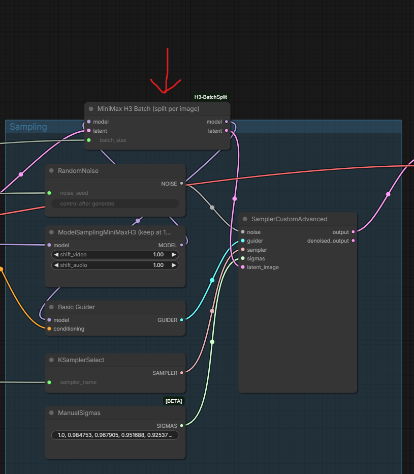

So you don't have to open the box every time, the **batch_size** can be shown on the outside of it, at the bottom with the other settings:

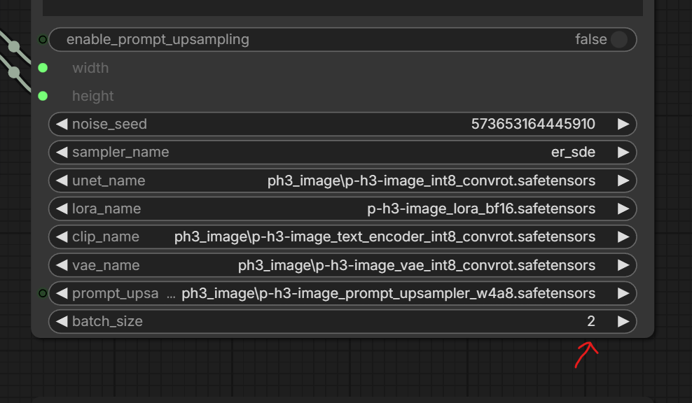

The included workflows that use a box like this already have **batch_size** on the outside, with the **Batch size** node plugged into it.

Searching "h3 batch" finds both nodes:

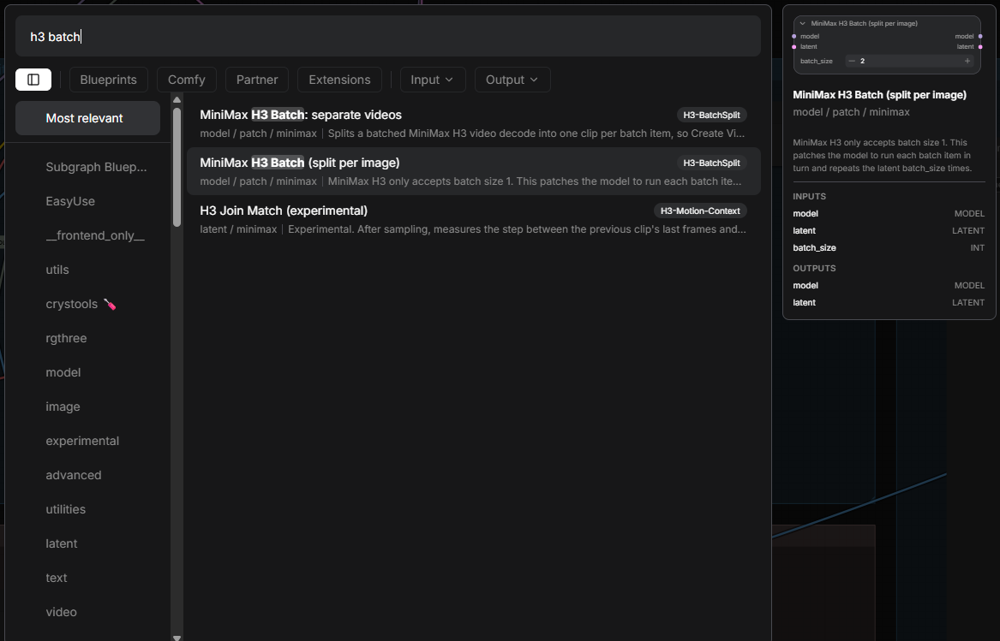

<!-- SCREENSHOT: assets/howto/03_image_before.png (template before: model and latent going straight into the sampler) -->
<!-- SCREENSHOT: assets/howto/05_open_subgraph.png (how to open a subgraph) -->

Here it is in the MiniMax H3 Image edit template. The **model** and **latent** wires go into the batch node first, and its two outputs go on to the **KSampler**:

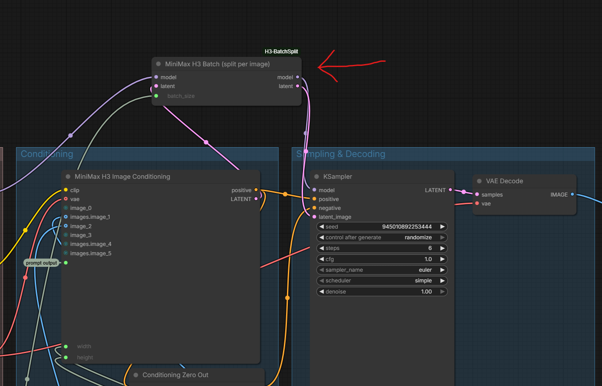

And the whole workflow after one run, so you can see where everything sits. The batch node is at the top, the **Int** node that sets the batch size is in the **User Inputs** group, and both images from the one run are in **Save Image** on the right:

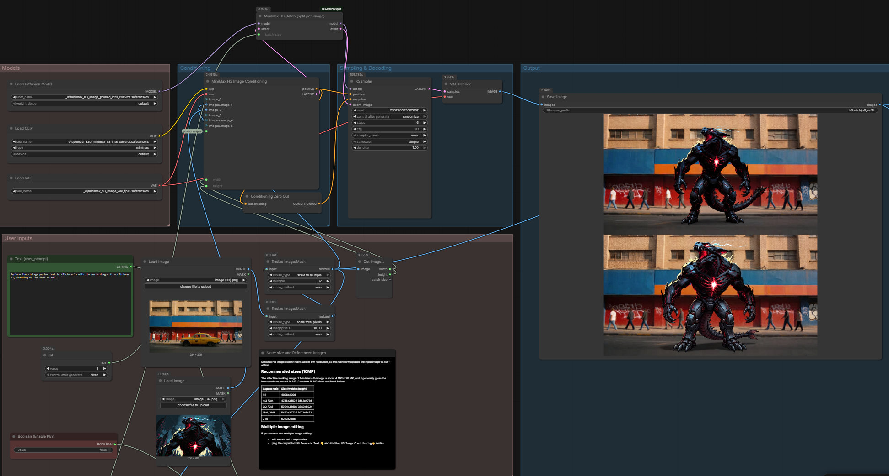

### Videos (MiniMax H3 text, image and reference to video)

1. Double-click the canvas and search "MiniMax H3 Batch".
2. Add **MiniMax H3 Batch (split per image)**.
3. Find the wire going into the sampler's **model** input.
4. Plug it into the new node's **model** instead.
5. Connect the new node's **model** output to the sampler (**SamplerCustomAdvanced** with **BasicGuider**).
6. Do the same with the **latent** wire that goes into the sampler's **latent_image**.
7. Also add **MiniMax H3 Batch: separate videos**.
8. Plug the wire from **VAE Decode** into its **images**.
9. Plug the wire from **VAE Decode Audio** into its **audio**.
10. Connect its two outputs to **Create Video**.
11. Leave its **batch_size** at 0; it works out the number by itself.

Why the second node? Without it, all clips are glued into one video with only the first clip's sound. With it, you get one video file per clip, each with its own sound.

<!-- SCREENSHOT: assets/howto/06_video_batch_node.png (batch node placed in a video workflow) -->
<!-- SCREENSHOT: assets/howto/07_video_separate_node.png (separate videos node between the decoders and Create Video) -->
<!-- SCREENSHOT: assets/howto/08_video_results.png (output folder or queue showing one file per clip) -->

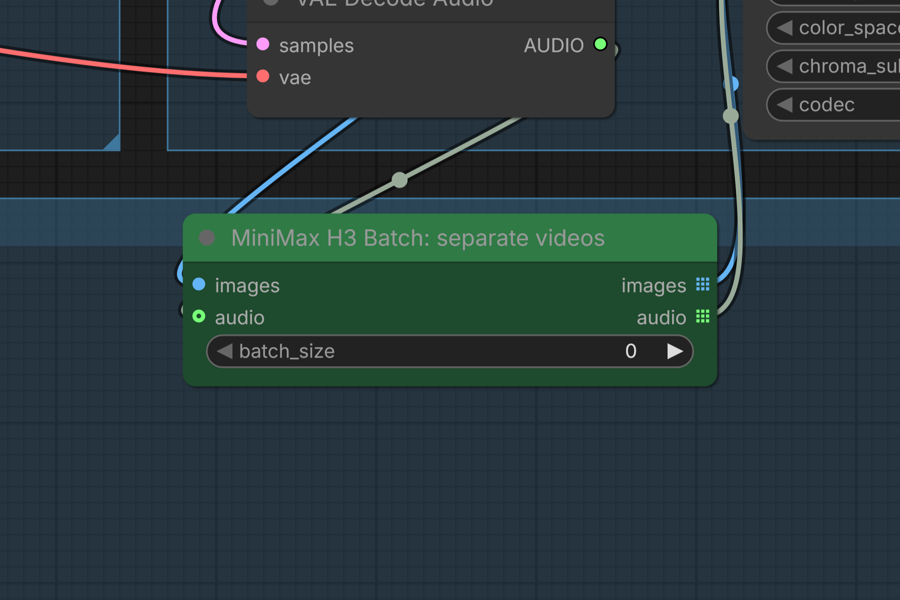

### Tip: keep batch size with your other settings

The batch node often sits in the middle of the workflow, or inside a subgraph, so it can be a pain to find every time you want to change the number. I add an **Int** node (double-click the canvas and search "Int"), connect its **INT** output to the batch node's **batch_size**, and park it in the **User Inputs** group next to the prompt and images. Now the number of images is set right where everything else is. The included workflows already come set up this way.

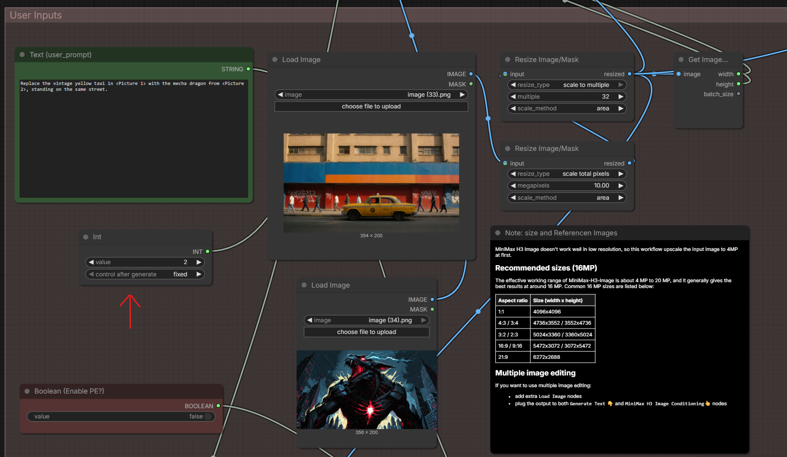

### Screenshots of every official template

The added nodes are coloured green only in the screenshots.

<details>
<summary>MiniMax H3 Image text to image</summary>
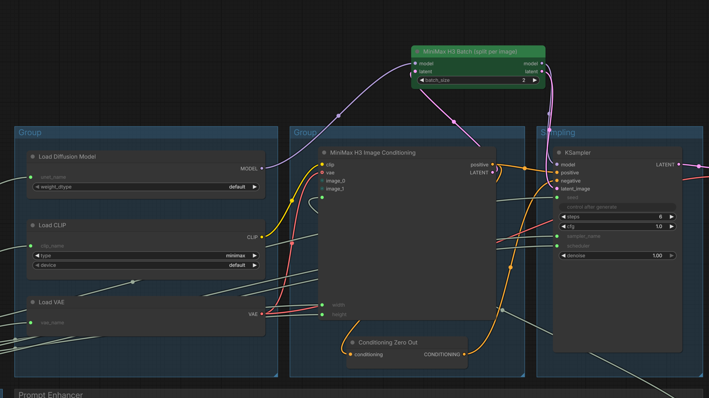
The batch node goes inside the subgraph, next to the sampler.
</details>

<details>
<summary>MiniMax H3 Image edit</summary>
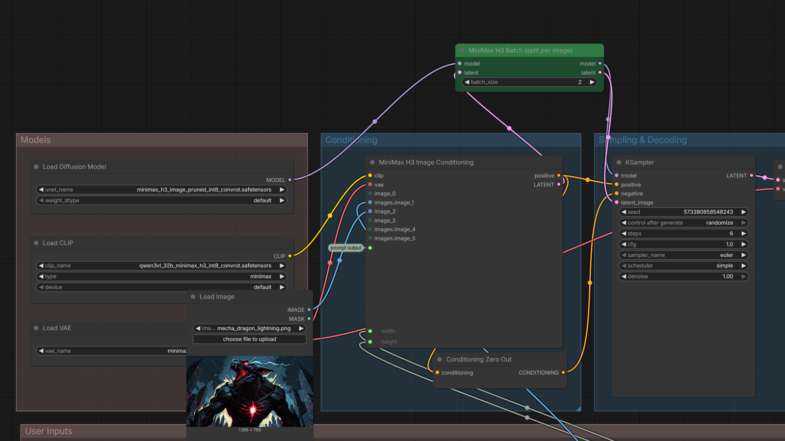
The batch node goes between the model loader and the sampler.
</details>

<details>
<summary>P-H3-Image text to image</summary>
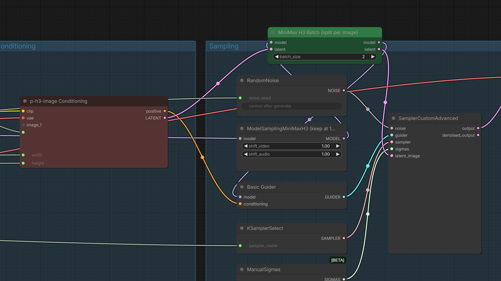
The batch node goes inside the subgraph, next to the sampler.
</details>

<details>
<summary>P-H3-Image edit</summary>
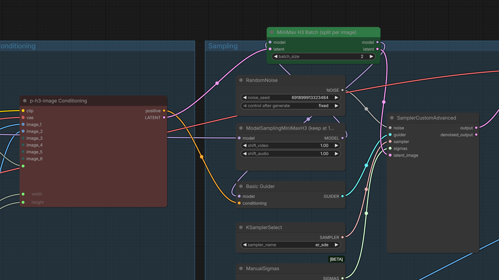
The batch node goes between the model loader and the sampler.
</details>

<details>
<summary>H3 text to video and H3 image to video</summary>
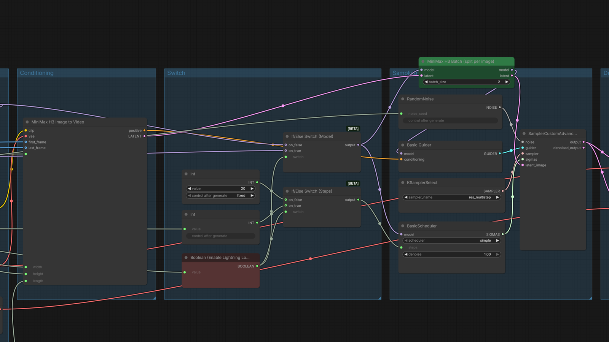
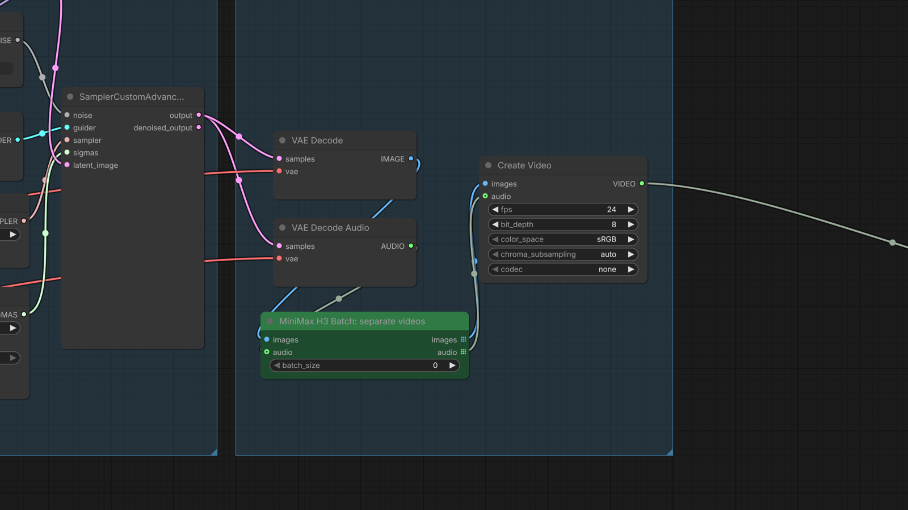
These two official templates are laid out the same way inside, so the steps are identical. The batch node goes inside the subgraph next to the sampler; the separate videos node goes between the two decoders and Create Video.
</details>

<details>
<summary>H3 reference to video</summary>
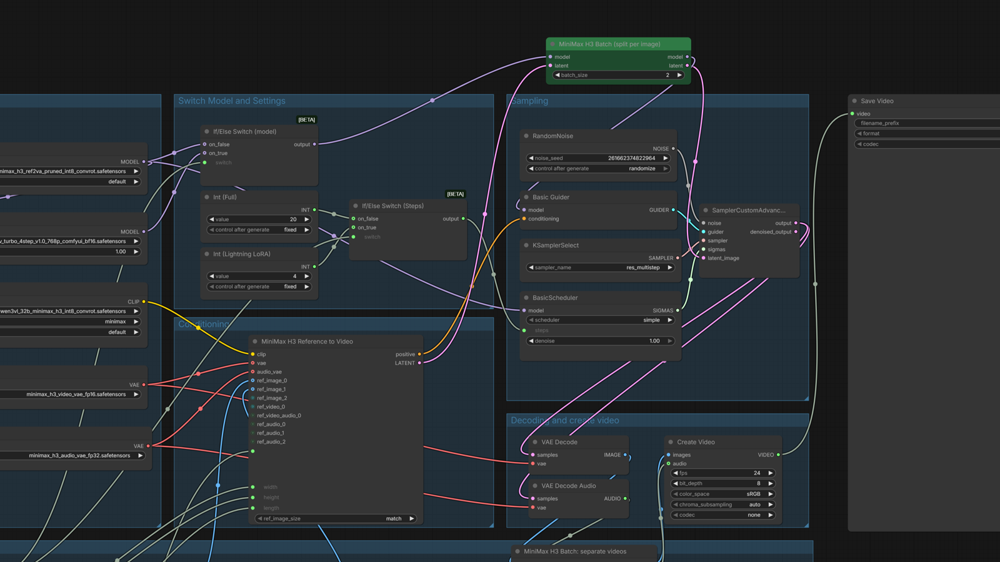
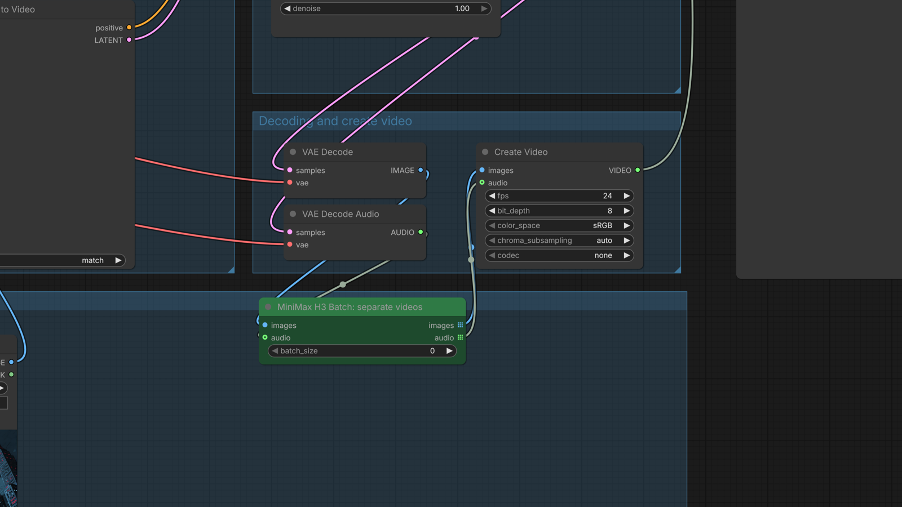
The batch node goes between the model and the sampler; the separate videos node goes between the two decoders and Create Video.
</details>

## What it does behind the scenes

MiniMax H3 can only work on one image at a time. The node feeds the images to it one by one on every step and puts the results back together. This means the model never sees more than one and does not complain. Each image starts from different noise from the same seed, so they all come out different. It does not change any ComfyUI files. Remove the node and everything is back to normal. At batch size 1 it changes nothing.

## Why it works this way

**Why not just raise the run count next to Run?** A batch is one job. The prompt and reference images are read once. The model loads once. All results land together. Total time is about the same.

**Why not change ComfyUI itself?** Updates would undo or break it. A node can just be removed.

**Why does video need a second node?** Clips only become separate videos after decoding. That is where the split happens.

**Why does batch_size start at 2?** Adding the node by accident at most doubles the time.

## Good to know

*   It is not faster. 4 images take about 4 times as long as 1. But you only press **Run** once.
*   It uses about the same graphics memory as one image.
*   All results come from one seed. Re-running with the same seed gives the same set. You cannot remake just image 3 by itself.
*   It is tested only with MiniMax H3 models. Other models do not need it.
*   A big future ComfyUI update could break it. In that case, it will need an update.

## How it was tested

I opened every official MiniMax H3 template in ComfyUI, added the nodes, set batch size 2 and pressed **Run**. I did this on three graphics cards (RTX 5070 Ti, RTX 3090 and RTX 5060 Ti) with ComfyUI 0.45.2. Every image and clip at the top of this page came from those runs.

| Template | Result |
| :--- | :--- |
| MiniMax H3 Image text to image | 2 different images |
| MiniMax H3 Image edit | 2 different images |
| P-H3-Image text to image | 2 different images |
| P-H3-Image edit | 2 different images |
| H3 text to video | 2 separate videos, each with its own sound |
| H3 image to video | 2 separate videos, each with its own sound |
| H3 reference to video | 2 separate videos, each with its own sound |

The prompt helper was switched off on the official image templates because that model wasn't installed. Turbo LoRAs and short clips were used for video.

## If something goes wrong

**"MiniMax H3 supports batch size 1"**
The node is not between the model/latent and the sampler. Or it sits outside the subgraph that holds the sampler. Set the batch size on the node, not on an empty-latent node.

**Only one image comes out**
The sampler's **latent_image** is still wired to the old node instead of the batch node.

**One mp4 with all clips and one soundtrack**
The **MiniMax H3 Batch: separate videos** node is missing. Add it between the decoders and **Create Video**.

**"frames do not divide into N clips"**
Set the **batch_size** on the separate videos node to match the first node. Or connect audio.

**Loaders outlined red after opening a template**
Model files are named differently or in subfolders. Pick them in the dropdowns.

## About this project

I love using ComfyUI so much that I have a YouTube channel for it: [@TheComfyAdmin](https://www.youtube.com/@TheComfyAdmin). I've been using MiniMax H3 more than any other model, and I've fallen in love with it.

One thing that really bothered me: other models (like Flux.2 Klein 9B) let me make images in batches, and MiniMax H3 didn't. Batches help me so much. Without them, I make one, wait, study it, click **Run** again, wait, study it, and so on. With them, I can make 2 to 9 at once and save a lot of time.

I got tired of not being able to do that with MiniMax H3, so I grabbed Claude Code and went to work. Not much later, I had it figured out. As you can see, the results speak for themselves. I hope you enjoy it!

If you have any issues with this, please open a new issue in this GitHub repo so I can address it.

P.S. If you like my other custom node, ComfyUI Watcher, I have a desktop companion app for it that I'm going to put on my Patreon page once I get it all set up. The name of the page will more than likely be "The Comfy Admin".

I'm going to be releasing a lot more of my personal projects that I've made with my 20 years of IT experience and Claude Code. They're really unique and helpful. Keep an eye on my [GitHub](https://github.com/an80sPWNstar) and Patreon pages for when they get released!

Thanks for your support!

## Credits

ComfyUI and Comfy-Org for the MiniMax H3 integration and the official workflow templates (the reference images in `assets/inputs` come from those templates). MiniMax for the H3 models. Pruna for P-H3-Image.

## License

MIT, see LICENSE.
